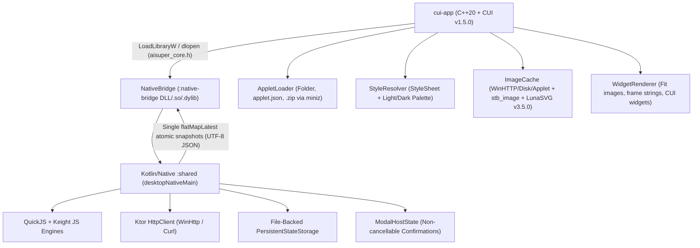

---
categories:
- architecture
- system-overview
created: '2026-11-26T08:06:07.173270+00:00'
id: cui-native-frontend
modified: '2026-11-26T08:06:07.173361+00:00'
tags:
- cui
- cpp
- kotlin-native
- dll
- c-abi
- desktop
- lunasvg
- architecture
- frontend
title: CUI + Kotlin/Native Desktop Frontend
type: leaf
---

# CUI + Kotlin/Native Desktop Frontend

## 1. Overview & Motivation

The **CUI + Kotlin/Native Desktop Frontend** provides a lightweight, zero-JVM desktop runtime for AISuper by pairing a thin C++20 native UI shell (`cui-app/`) built on [yappologistic/CUI (`v1.5.0`)](https://github.com/yappologistic/CUI) with AISuper's existing `:shared` Kotlin Multiplatform core compiled to a native shared library (`:native-bridge`).

Instead of re-implementing JS engine sandboxing, storage scoping, layout models, HTTP cookies, or module bindings in C++, `cui-app/` runs the exact `:shared` `HeadlessSession` logic in-process across a minimal C ABI (`include/aisuper_core.h`).

- **Binary Footprint**: `aisuper_cui.exe` is ~1.1 MB and stripped Release `aisuper_core.dll` is ~9.3 MB (0 COFF symbols, no bundled JRE or Node/WebView2 dependency).
- **Dynamic Linking Strategy**: `aisuper_core` is loaded at runtime via `LoadLibraryW` / `GetProcAddress` on Windows (`dlopen` / `dlsym` on Linux/macOS), avoiding MinGW-vs-MSVC static ABI mismatches.

---

## 2. Architecture & Data Flow



---

## 3. Kotlin/Native Core & `:native-bridge`

### 3.1. Targets & Audio/RPC Decoupling
- **Configured Targets**: `mingwX64()`, `linuxX64()`, and `macosArm64()` in `:shared`, `:native-bridge`, and `packages/rpc-core`.
  - *Note*: Kotlin/Native does not currently provide a `mingwArm64` target; Windows ARM64 systems run the x64 build via x64 emulation.
- **`packages/rpc-core`**: Replaced iOS-only synchronization with `nativeMain` (`RpcPlatformNative.kt`) using `AtomicInt` spinlock + `Clock.System`.
- **`:shared` Source Sets**: Compose audio (`composemediaplayer-audio` / `Dispatchers.Main`) was decoupled into `composeAudioMain`, while `desktopNativeMain` keeps **both QuickJS and Keight** JS engines enabled, binds Ktor `WinHttp` (Windows) / `Curl` (Linux/macOS), uses file-backed `PersistentStateStorage` (`StorageDir.{mingw,linux,macos}.kt`), and provides `StubAudioPlayer` (no-op audio backend).

### 3.2. C ABI & Atomic Snapshots (`NativeBridge.kt`, `aisuper_core.h`)
Exports 7 flat `@CName` functions:
- `aisuper_session_create(on_snapshot, on_error, read_file, free_buf, user_data)`
- `aisuper_session_load_applet(handle, manifest_path)`
- `aisuper_session_send_action(handle, action, args_json)`
- `aisuper_session_set_value(handle, id, value_json)`
- `aisuper_session_module_command(handle, module_type, target, command, args_json)`
- `aisuper_session_respond_modal(handle, modal_id, confirmed)`
- `aisuper_session_destroy(handle)`

To eliminate torn intermediate snapshots when switching features, `feature.values` and `feature.layoutRoot` are combined inside a single `applet.currentFeature.flatMapLatest { ... }` and filtered for `featureId.isNotEmpty() && layout != null`.

### 3.3. Release Symbol Stripping
`kotlin/native-bridge/build.gradle.kts` hooks `linkTaskProvider` for `NativeBuildType.RELEASE` (configuration-cache compatible) to run Konan's `strip.exe --strip-unneeded` on `mingwX64` (`strip -x` on macOS, `strip --strip-unneeded` elsewhere), shrinking `aisuper_core.dll` from ~12.5 MB to ~9.3 MB with zero COFF symbols while keeping all 7 `@CName` DLL exports intact.

---

## 4. C++20 Frontend (`cui-app/`) Components

| Component | Files | Responsibility |
|---|---|---|
| **Core Bridge** | `src/core_bridge.{hpp,cpp}` | Dynamic library loading, C callback marshaling, thread-safe snapshot queue, `wake_ui()` integration |
| **Applet Loader** | `src/applet_loader.{hpp,cpp}` | Resolves folder applets, direct `applet.json`, and `.zip` archives (`miniz 3.0.2`), handling `files/` prefixes |
| **Style Resolver** | `src/style_resolver.{hpp,cpp}` | Maps AISuper `StyleSheet` rules, classes, and hex/semantic colors onto CUI themes and widget options |
| **Image & SVG Cache** | `src/image_cache.{hpp,cpp}`, `src/stb_mem.c` | Fetches local/HTTP/data-URI images; rasterizes SVGs with **LunaSVG (`v3.5.0`)** + stylesheet `svg { color: ... }` injection for `currentColor`, scaled cleanly to `target_max_dim` |
| **Widget Renderer** | `src/widget_renderer.{hpp,cpp}` | Renders widget trees; copies transient UI strings (`placeholder`, dialog descriptions) via `cui_frame_strdup`; computes Fit (`contain`) dimensions inside centered/aligned wrapper boxes |
| **Desktop Host** | `src/main.cpp` | Toolbar pickers (`Folder`, `.zip / .json`), OS drag-and-drop, persistent confirmation dialogs (`ModalDialogSystem`), and live JSON Snapshot Inspector |
| **Smoke Test** | `tests/smoke_test.cpp` | Headless CUI software-renderer verification (DLL load, menu render, modal round-trip, LunaSVG `dynamic_svg` + `currentColor`, Fit aspect ratio check) |

### 4.1. Image Fit (`contain`) Sizing
Because `cui_image_ex` stretches textures across its assigned `width x height`, `WidgetRenderer` wraps every `Image` widget in a `CUI_ROW` box (`wrap.id = "img_wrap"`) and computes `scale = min(max_w / iw, max_h / ih)` via `fit_dimensions(...)`:
- For `fillMaxWidth` / `fillMaxSize` / weighted row images: measures the wrapper box's laid-out width from `cui_get_rect(ui, wrap_id).w` (requesting a redraw if `<= 1.0` on frame 1) and bounds height to explicit `height` or default `200.0` (matching Compose's `200.dp`).
- For fixed-size images: fits inside `(height ?: 64) x (height ?: 64)`.
- Button icons similarly fit within `18x18` so non-square icons never distort.

---

## 5. Build, Run & Verification

### 5.1. Build `aisuper_core.dll` (from `kotlin/`)
```powershell
.\gradlew.bat :native-bridge:linkReleaseSharedMingwX64
```

### 5.2. Configure & Build `cui-app` (Windows MSVC + Ninja)
```powershell
cmd /c "call `"C:\Program Files\Microsoft Visual Studio\18\Community\VC\Auxiliary\Build\vcvars64.bat`" >nul && cmake -S d:\Work\Mobile\Android\AISuper\cui-app -B d:\Work\Mobile\Android\AISuper\cui-app\build -G Ninja -DCMAKE_BUILD_TYPE=Release && cmake --build d:\Work\Mobile\Android\AISuper\cui-app\build --config Release"
```

### 5.3. Run GUI & End-to-End Smoke Test
```powershell
.\cui-app\build\aisuper_cui.exe "d:\Work\Mobile\Android\AISuper\.agents\sample-applets\widgets\applet.json"
.\cui-app\build\aisuper_cui_smoke.exe "d:\Work\Mobile\Android\AISuper\.agents\sample-applets\widgets\applet.json"
```

## Related Pages
- [[architecture-overview|Architecture Overview]]
- [[ui-layout-system|UI and Layout System]]
- [[applet-lifecycle|Applet Lifecycle and Loading]]
- [[modal-dialog-system|Modal Dialog and Confirmation System]]