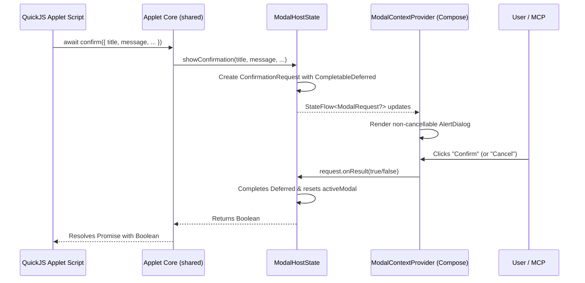

---
categories:
- system-overview
- architecture
created: '2026-11-08T02:31:36.017418+00:00'
id: modal-dialog-system
modified: '2026-11-08T02:31:36.017440+00:00'
tags:
- modal
- dialog
- confirmation
- ui
- architecture
- compose
- quickjs
title: Modal Dialog and Confirmation System
type: leaf
---

# Modal Dialog and Confirmation System

## 1. Overview & Architecture

The AISuper Modal Dialog System provides a decoupled, awaitable, and extensible modal presentation architecture for applets and native components.

### Core Architectural Goals:
1. **Decoupled from Widget Renderers**: Modal presentations are **never** hardcoded into layout tree renderers (`Material3LayoutRenderer`, `RikkaLayoutRenderer`). They live in a standalone modal host layer.
2. **Async / Awaitable**: JavaScript applet scripts can `await confirm(...)` seamlessly. The QuickJS coroutine suspends until the user interacts with the dialog.
3. **Non-Cancellable Semantics**: Security-critical confirmations (such as arming or disarming physical alarm systems) cannot be dismissed accidentally by clicking outside the dialog or pressing the back key. The user must explicitly choose either the Confirm or Cancel action.
4. **Extensible Primitives**: Built on a sealed `ModalRequest` hierarchy, allowing easy addition of future primitives (`Alert`, `Prompt`, `BottomSheet`, `ActionSheet`).



---

## 2. Shared Core Models (`com.damn.aisuper.modal`)

Defined in `shared/src/commonMain/kotlin/com/damn/aisuper/modal/ModalModels.kt`:

- `ModalRequest`: Sealed interface defining any modal request presented over the UI.
- `ConfirmationRequest`: Confirmation modal primitive containing:
  - `title`: Header text
  - `message`: Description text
  - `confirmText`: Label for positive action (default `"Подтвердить"` / `"OK"`)
  - `cancelText`: Label for negative action (default `"Отмена"`)
  - `isDestructive`: Boolean flag to highlight destructive actions with error/warning styling
  - `onResult: (Boolean) -> Unit`: Callback returning user decision
- `ModalHostState`: Interface with:
  - `val activeModal: StateFlow<ModalRequest?>`
  - `suspend fun showConfirmation(...): Boolean`
  - `fun respondToActive(confirmed: Boolean): Boolean`
  - `fun dismissCurrent()`
- `DefaultModalHostState`: Multiplatform thread-safe implementation backed by Kotlin Coroutines (`CompletableDeferred`).

---

## 3. Compose Modal Context Provider (`composeApp`)

Defined in `composeApp/src/commonMain/kotlin/com/damn/aisuper/modal/ModalContextProvider.kt`:

- `LocalModalHost`: CompositionLocal exposing `ModalHostState` down the composable hierarchy.
- `ModalContextProvider`: Composable host that wraps the application content and displays active modals on top:
  - Completely decoupled from [[ui-layout-system|UI layout system]] and widget renderers.
  - Uses `DialogProperties(dismissOnBackPress = false, dismissOnClickOutside = false)` to enforce **non-cancellable** operation.
  - Automatically styles positive buttons based on `isDestructive`.
  - Can be extended with additional `when (modal)` branches for future modal primitives without altering layout rendering logic.

---

## 4. JavaScript Applet API

Global functions available in every feature script:

```typescript
interface ConfirmationOptions {
    title?: string;
    message: string;
    confirmText?: string;
    cancelText?: string;
    isDestructive?: boolean;
}

declare function confirm(options: ConfirmationOptions | string, title?: string): Promise<boolean>;
declare function showConfirmation(options: ConfirmationOptions | string, title?: string): Promise<boolean>;
declare function confirmation(options: ConfirmationOptions | string, title?: string): Promise<boolean>;
```

### Usage Example: Guard Toggle Confirmation

```javascript
async function onToggleProtection(objectId, targetState) {
    var title = targetState ? "Постановка на охрану" : "Снятие с охраны";
    var actionVerb = targetState ? "поставить объект на охрану" : "снять объект с охраны";
    var message = "Вы уверены, что хотите " + actionVerb + "?";

    // Non-cancellable awaitable confirmation
    var confirmed = await confirm({
        title: title,
        message: message,
        confirmText: targetState ? "Поставить" : "Снять",
        cancelText: "Отмена",
        isDestructive: !targetState // Highlight disarming in red/destructive
    });

    if (!confirmed) {
        return; // User canceled; do not perform action
    }

    // Proceed with secure operation
    await security_toggleProtection(String(objectId), String(targetState));
}
```

---

## 5. AI Harness / MCP Automation Tools

For headless testing and AI agent automation, the MCP server provides dedicated tools (see [[ai-harness-skill|AI Harness Skill]]):

- `modal_get`: Returns `{ "active": true, "type": "confirmation", "id": "...", "title": "...", "message": "...", "isDestructive": true }` or `{ "active": false }`.
- `modal_respond`: Programmatically answers the active confirmation modal with `{ "confirm": true }` or `{ "confirm": false }`.

---

## 6. Reference Sample

A full runnable sample demonstrating standard, destructive, and quick string confirmation dialogs is available in `.agents/sample-applets/widgets/` under the feature `confirmation` (`files/confirmation_layout.json` and `files/confirmation_script.js`).