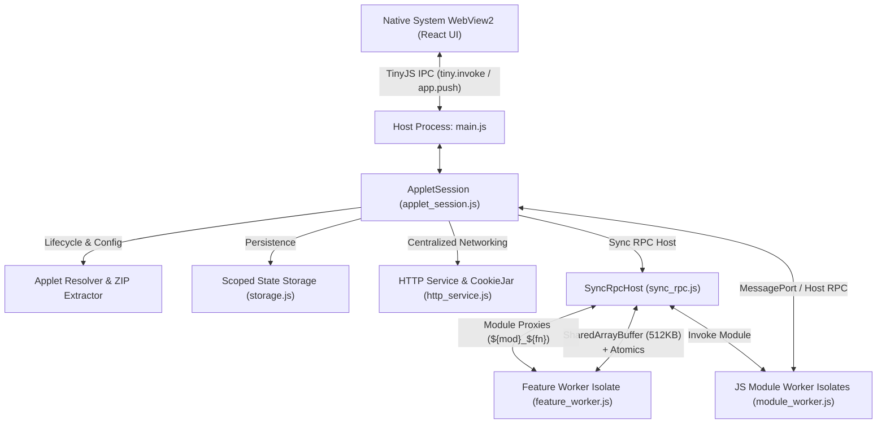

---
categories:
- architecture
created: '2026-11-08T04:01:32.145297+00:00'
id: tinyjs-runtime
modified: '2026-11-14T03:01:23.817704+00:00'
tags:
- tinyjs
- quickjs
- txiki
- pure-js
- runtime
- architecture
- workers
- sync-rpc
- networking
title: TinyJS Pure JavaScript Runtime Architecture
type: category
---

# TinyJS Pure JavaScript Runtime Architecture

<!-- human:start -->
## 1. Executive Summary & Motivation

The **TinyJS Pure JavaScript Runtime** is a self-contained, high-performance desktop implementation of the AISuper container built on top of **[TinyJS](https://tinyjs.app/)** (`txiki.js v26.11.0` / QuickJS-ng + libuv backend with a native system WebView2 frontend).

### Key Architectural Tenets:
- **Zero JVM / Node.js Dependency**: The entire runtime compiles to a standalone, portable Windows executable (~6.2 MB) at `tinyjs-app/dist/aisuper.exe`.
- **Strict JavaScript VM Isolation**: Applet features and JS business modules execute in dedicated Web Worker threads (QuickJS isolates) with no shared heap.
- **Synchronous Blocking RPC Bridge**: Preserves backward compatibility with legacy synchronous applet APIs (`getValue`, `setValue`, `storageGet`, module proxy methods) using `SharedArrayBuffer` and `Atomics.wait/notify` without burning CPU.
- **Parity with Kotlin Multiplatform Runtime**: Features full parity with AISuper Kotlin KMP implementation, including centralized cookie jar networking (`install(HttpCookies)`), non-cancellable modal confirmation dialogs, scoped state storage, and dynamic multi-layout rendering.

---

## 2. Component Architecture Overview



---

## 3. Worker Isolates & Cross-Module Communication

AISuper applets separate UI presentation (Features) from reusable business logic (JS Modules).

### 3.1. Feature Worker Isolates
- When a feature is launched (`session.launchFeature(featureId)`), an isolate worker (`feature_worker.js`) is spawned.
- The feature's initial script is evaluated into `globalThis` (with `"use strict";` stripped to prevent local lexical scoping of indirect eval).
- When transitioning features (`launchFeature('cabinet')`), all pending promises on the old worker are resolved before the worker is gracefully terminated, preventing UI hangs.

### 3.2. Applet-Scoped JS Module Isolates
- Declared in `applet.json` under `manifest.modules` or `feature.modules` (`type: "jsModule"`).
- Spawned once per applet and **retained across feature transitions**. Module heaps and variables (e.g. `currentUser`) persist in memory throughout the user session.
- Modules export callable methods using `registerExports(moduleName, [functionNames...])`.
- The host session creates dynamic `${moduleName}_${functionName}` proxy functions in the active feature isolate, bridging calls synchronously across isolates.

---

## 4. Centralized HTTP Service & Cookie Jar

Strict enterprise and security APIs (such as SecUnit / Armada) require centralized session handling matching Kotlin KMP's `HttpComponent` with `install(HttpCookies)`:

1. **Shared Cookie Jar**: When `auth_module.js` calls `POST /Auth/api/signin`, the ASP.NET authentication cookies are recorded in the host's `CookieJar`. Subsequent requests from `security_module.js` or `kids_tracker_module.js` automatically carry those cookies.
2. **Multi-Cookie Header Parsing**: In `txiki.js`, multiple `Set-Cookie` headers are concatenated with semicolons. The parser identifies cookie boundary attributes (`Path`, `Expires`, `Domain`, `Secure`, `HttpOnly`) to cleanly extract all distinct cookies.
3. **Subdomain Matching**: Cookies set on `.secunit.ru` match API calls to `services.secunit.ru`.
4. **HTTP 411 Length Required Handling**: Explicitly attaches `Content-Length: '0'` for empty `POST` or `PUT` calls (such as `/Auth/api/SessionToken`), preventing IIS / ASP.NET reverse proxies from rejecting requests with 411.
5. **Token Architecture**:
   - `auth.token`: Long-lived Master Bearer JWT.
   - `auth.sessionToken`: 1-hour secondary session token issued by `POST /Auth/api/SessionToken`.
   - `security_module.js` automatically re-acquires a fresh session token if an API call returns 400 or 401.

---

## 5. Modal Dialog & Confirmation System

Implements the decoupled, non-cancellable confirmation dialog specification (see [[modal-dialog-system|Modal Dialog and Confirmation System]]):
- Scripts invoke `var ok = await confirm({ title, message, confirmText, cancelText, isDestructive })`.
- The worker isolate suspends until the user interacts with the dialog.
- The dialog cannot be dismissed by clicking outside or pressing Escape; the user must explicitly choose Confirm or Cancel.
- Destructive actions (e.g. Disarm, Delete) receive distinct red accent styling.

---

## 6. Development, Build, and Testing Guide

### 6.1. Prerequisites
- `tinyjs` CLI: Available on PATH or via `$env:LOCALAPPDATA\tinyjs\tinyjs.cmd`.
- `tjs.exe`: Located at `$env:LOCALAPPDATA\tinyjs\bin\tjs.exe`.

### 6.2. Development Workflow
From the `tinyjs-app/` directory:
```powershell
# Run the application in development mode with live reload
& "$env:LOCALAPPDATA\tinyjs\tinyjs.cmd" dev

# Build the portable standalone Windows executable (dist/aisuper.exe)
& "$env:LOCALAPPDATA\tinyjs\tinyjs.cmd" build
```

### 6.3. Running the Applet
```powershell
# Run with a directory
.\tinyjs-app\dist\aisuper.exe "d:\path\to\armada\applet"

# Run with a direct manifest file
.\tinyjs-app\dist\aisuper.exe "d:\path\to\applet.json"

# Run with a compressed ZIP archive
.\tinyjs-app\dist\aisuper.exe "d:\path\to\applet.zip"

# Run without arguments (displays interactive drag-and-drop landing screen)
.\tinyjs-app\dist\aisuper.exe
```

### 6.4. Automated Verification Test Suites
Run all automated test suites directly via the `tjs` runtime:

```powershell
# 1. Armada Applet & JS Module Integration Suite
& "$env:LOCALAPPDATA\tinyjs\bin\tjs.exe" run tinyjs-app/src/backend/test_armada_suite.js

# 2. Comprehensive Widgets Demo Feature Suite
& "$env:LOCALAPPDATA\tinyjs\bin\tjs.exe" run tinyjs-app/src/backend/test_full_suite.js

# 3. Native Modal Confirmation Dialog Suite
& "$env:LOCALAPPDATA\tinyjs\bin\tjs.exe" run tinyjs-app/src/backend/test_confirmation.js

# 4. ZIP Archive Extraction & Loading Suite
& "$env:LOCALAPPDATA\tinyjs\bin\tjs.exe" run tinyjs-app/src/backend/test_zip.js
```
<!-- human:end -->

## Subsystem Implementation Modules

<!-- ai:start -->
### [[src:internals/tinyjs/main|main.js (Backend Entry Point)]]
The root process file executed by txiki.js. Manages the host process lifecycle, command-line argument discovery, native OS drag & drop events, and frontend RPC endpoints.

### [[src:internals/tinyjs/applet-session|applet_session.js (AppletSession Lifecycle)]]
Central host session orchestrator. Manages manifest parsing, theme stylesheets, isolate orchestration for features and modules, and state snapshots delivered to the WebView.

### [[src:internals/tinyjs/sync-rpc|sync_rpc.js (Synchronous RPC Bridge)]]
High-performance SharedArrayBuffer + Atomics.wait/notify communication bridge enabling worker isolates to execute blocking host and cross-isolate calls without burning CPU.

### [[src:internals/tinyjs/http-service|http_service.js (Centralized HTTP Service & Cookie Jar)]]
Host-managed HTTP networking providing parity with Ktor's `install(HttpCookies)`. Features multi-cookie parsing, subdomain matching, and HTTP 411 Length Required prevention.

### [[src:internals/tinyjs/storage|storage.js (Scoped State Storage)]]
Transient in-memory and file-backed persistent storage (`aisuper_storage.json`) with fine-grained scoping (`applet`, `feature`, `module`, `global`).

### [[src:internals/tinyjs/applet-resolver|applet_resolver.js (Applet Manifest Resolver)]]
Resolves applet manifests across directories, direct JSON paths, and compressed ZIP archives.

### [[src:internals/tinyjs/zip-extractor|zip_extractor.js (Pure JS ZIP Extractor)]]
Zero-dependency archive decompression engine utilizing standard Web Streams `DecompressionStream('deflate-raw')`.

### [[src:internals/tinyjs/feature-worker|feature_worker.js (Feature Worker Isolate)]]
Sandboxed QuickJS worker thread for feature UI logic, reactive state bindings, layout switching, and confirmation modal dispatch.

### [[src:internals/tinyjs/module-worker|module_worker.js (JS Module Worker Isolate)]]
Sandboxed, long-lived worker isolate for applet business modules (`auth`, `armada_api`, `security`, `kids_tracker`) persisting across feature navigations.
<!-- ai:end -->